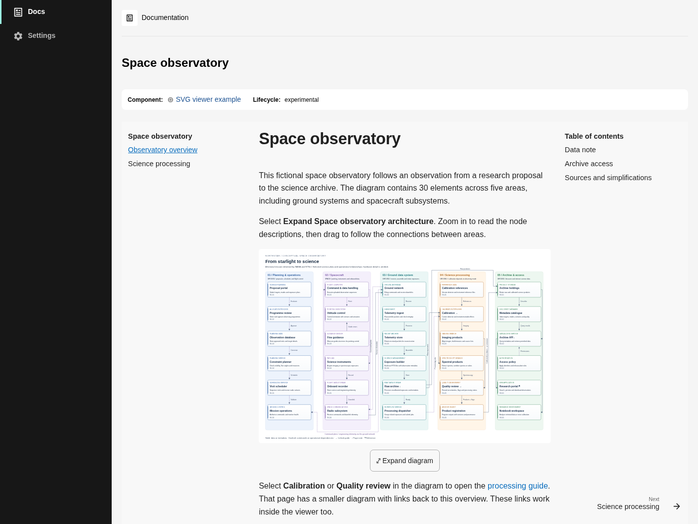
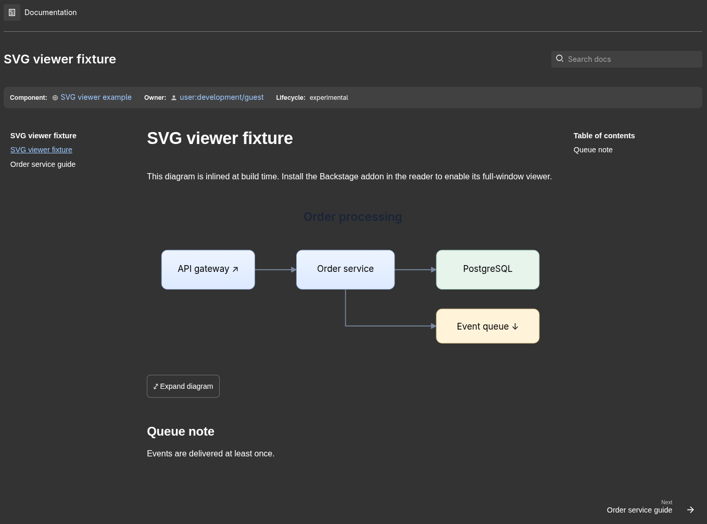
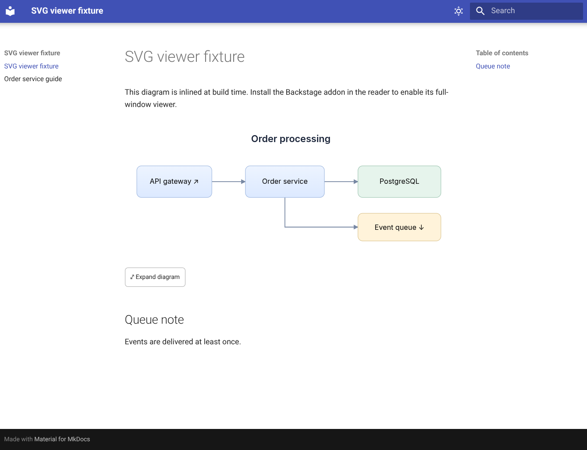
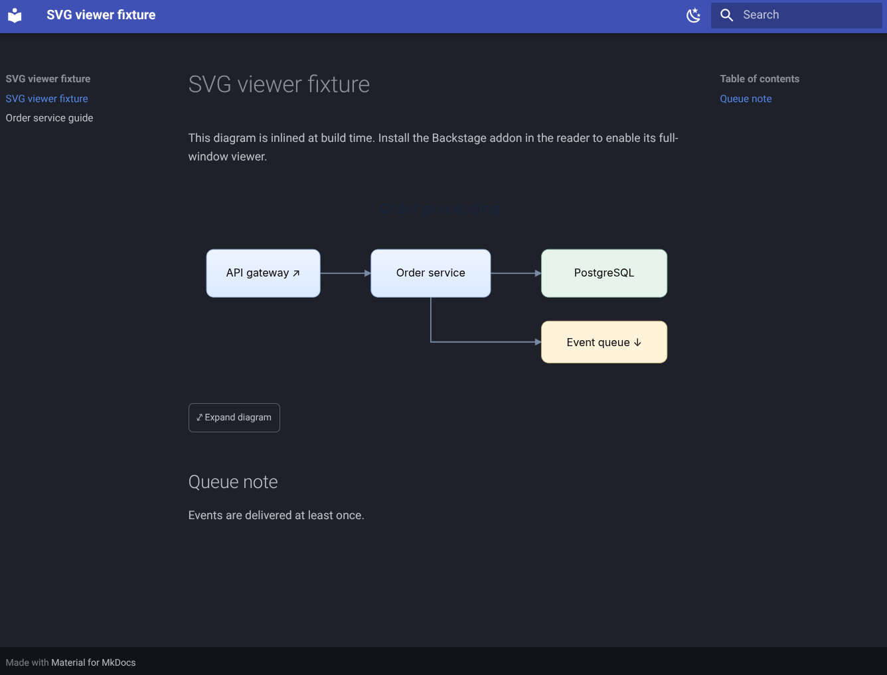
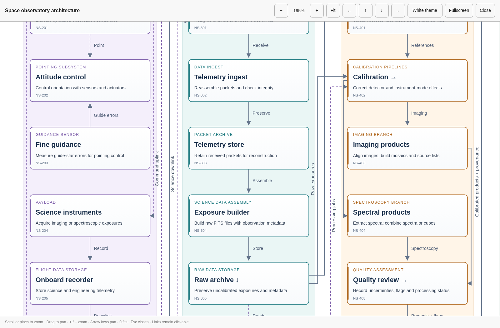
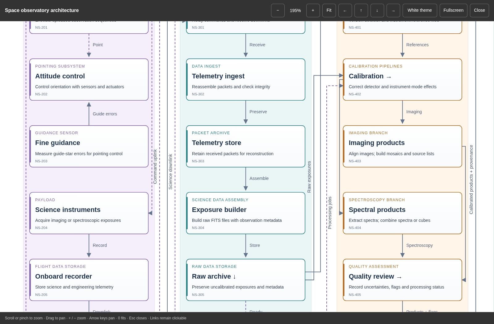

# Backstage TechDocs & MkDocs SVG viewer

[](https://github.com/mwz/techdocs-mkdocs-svg-viewer/releases/latest)
[](https://www.npmjs.com/package/@mwz/techdocs-mkdocs-svg-viewer/v/latest)
[](https://www.npmjs.com/package/@mwz/techdocs-mkdocs-svg-viewer/v/next)
[](https://cdn.jsdelivr.net/npm/@mwz/techdocs-mkdocs-svg-viewer@latest/dist/svg-viewer.js)
[](https://cdn.jsdelivr.net/npm/@mwz/techdocs-mkdocs-svg-viewer@next/dist/svg-viewer.js)

Click an inline SVG diagram to open it in a full-window, accessible viewer. The
viewer has zoom, mouse and touch panning, direction buttons and an optional
browser fullscreen mode.

The viewer is for SVGs that
[mkdocs-inline-select-svg-plugin](https://pypi.org/project/mkdocs-inline-select-svg-plugin/)
and similar plugins embed in the page. The viewer uses the original inline SVG,
so embedded links, text, gradients, markers, IDs and event listeners stay
available. The viewer does not rasterise the SVG or change it into an ``.

There are two ways to use the viewer:

- **Backstage TechDocs:** Install the package and register the addon. See
  [Legacy frontend](#legacy-frontend) or
  [New frontend system](#new-frontend-system).
- **MkDocs site outside Backstage:** Load the self-contained `svg-viewer.js`
  from a CDN with `extra_javascript`. You do not need a JavaScript toolchain.
  See [Standalone MkDocs site](#standalone-mkdocs-site-outside-backstage).

**Backstage**

| Light                                       | Dark                                      |
| ------------------------------------------- | ----------------------------------------- |
|  |  |

**MkDocs**

| Light                                 | Dark                                |
| ------------------------------------- | ----------------------------------- |
|  |  |

**SVG viewer**

| Light                                         | Dark                                        |
| --------------------------------------------- | ------------------------------------------- |
|  |  |

## Behaviour

- To open the viewer, click an **unlinked** area of the diagram, or click its
  **Expand diagram** button.
- When you click a link, the link opens, not the viewer. Links keep their
  destinations, targets, query strings, fragments and modifier-click behaviour.
- TechDocs resolves and routes only links that use `href`. Many exporters write
  links that have only the legacy `xlink:href`. For these links, the addon adds
  an `href` with the resolved URL. TechDocs then navigates in the app and does
  not reload the page. When the addon unmounts, it removes the attributes that
  it added.
- If TechDocs routes a link that you click in the viewer, the viewer closes so
  that you can see the destination. This includes a `#fragment` link on the same
  page.
- A mouse or touch drag pans the diagram, also when the drag starts on a linked
  node. When you release a drag, the link does not open. A normal click or
  keyboard activation opens the link.
- The wheel, the trackpad and a two-finger pinch zoom around the pointer or the
  pinch centre.
- Keyboard: `+`/`−` zoom, arrow keys pan, Shift+arrow pans farther, `0`/Home
  fits the diagram, and Escape closes the viewer. Labelled buttons are also
  available for all essential operations.
- The viewer fills the **browser viewport** immediately. A separate Fullscreen
  button uses the browser Fullscreen API when the browser supports it. The
  viewer does not need this API or permission to open.
- The native `<dialog>` element keeps focus in the viewer and makes the page
  behind it inert. When the viewer closes, it restores the SVG to the page and
  returns keyboard focus to the expand button.
- The viewer follows the TechDocs or Material for MkDocs colour palette,
  including light and dark themes. Colours defined in the SVG stay unchanged.
  Pages without these theme variables use the default light viewer palette.
- If a diagram is hard to read in the current theme, select **White theme** in
  the viewer toolbar. This restores the original light palette and white canvas.
  Select **Page theme** to follow the host palette again and clear the saved
  override. Your browser remembers this choice for all diagrams on the same
  website, including after reloads and browser restarts. This preference is
  separate from the website's theme and preserves the SVG artwork, zoom and pan.
  If browser storage is unavailable, the choice applies only to the open viewer.
- The viewer skips small icons, nested SVG viewports, Material theme icon
  wrappers and Mermaid diagrams (`.mermaid`, or an SVG `id` that starts with
  `mermaid`). The Mermaid addon has its own zoom controls.
- A MutationObserver finds diagrams that navigation or client rendering adds to
  the page.
- All processing stays in the page. The viewer has no services and no telemetry.

## Compatibility

The implementation is type-checked against these exact Backstage packages:

| Package                                              | Version   |
| ---------------------------------------------------- | --------- |
| `@backstage/plugin-techdocs-react`                   | `1.4.0`   |
| `@backstage/core-plugin-api`                         | `1.12.11` |
| `@backstage/frontend-plugin-api` (new frontend only) | `0.18.2`  |
| React                                                | `18.3.1`  |

Use the versions that align with your Backstage release. The `/alpha` entry
point uses the alpha `AddonBlueprint` API of Backstage. This API can change
between releases. Older Backstage versions can work with the legacy entry point,
but we did not test them. The peer range does not include React 19, because the
tested TechDocs package declares support for React 17 and 18 only.

All peer dependencies are optional. Thus you can use the `/viewer` entry point
without React or Backstage packages. A Backstage app already has these packages.

The package targets Node 24 LTS (`engines.node >=24`). Build your Backstage app
on Node 24 or later. On older Node versions, Yarn 1 refuses to install the
package.

The viewer needs a modern browser that supports native dialog, Pointer Events,
ResizeObserver and shadow DOM. Chromium browser tests cover real native SVG
navigation, mouse, keyboard and touch. The
[local Backstage example](examples/backstage/README.md) tests the addon in a
real TechDocs reader. Before you roll out the addon, test it in your own
TechDocs instance too.

## Install

From the root of your Backstage app, run:

```sh
yarn --cwd packages/app add @mwz/techdocs-mkdocs-svg-viewer
```

Then register the addon for the [legacy frontend](#legacy-frontend) or the
[new frontend system](#new-frontend-system). The package includes ESM, CommonJS
and TypeScript declarations.

To try unreleased changes from `main`, install a snapshot with the `next` tag:

```sh
yarn --cwd packages/app add @mwz/techdocs-mkdocs-svg-viewer@next
```

When a change to the package source merges to `main`, CI stages a snapshot, for
example `0.2.1-main.42.gabc1234`. The snapshot is available after a maintainer
approves it. Snapshots are not stable releases.

### Legacy frontend

Add `SvgViewer` to the existing `TechDocsAddons` registry in your reader route:

```tsx
import { TechDocsReaderPage } from '@backstage/plugin-techdocs';
import { TechDocsAddons } from '@backstage/plugin-techdocs-react';
import { SvgViewer } from '@mwz/techdocs-mkdocs-svg-viewer';

<Route path="/docs/:namespace/:kind/:name/*" element={<TechDocsReaderPage />}>
  <TechDocsAddons>
    <SvgViewer />
    {/* Keep any other existing addons here. */}
  </TechDocsAddons>
</Route>;
```

If you use the entity documentation tab, also register the addon there:

```tsx
import { EntityTechdocsContent } from '@backstage/plugin-techdocs';

<EntityTechdocsContent>
  <TechDocsAddons>
    <SvgViewer />
  </TechDocsAddons>
</EntityTechdocsContent>;
```

### New frontend system

Add the module to the existing `features` list of your app:

```tsx
import { createApp } from '@backstage/frontend-defaults';
import { techDocsSvgViewerModule } from '@mwz/techdocs-mkdocs-svg-viewer/alpha';

const app = createApp({
  features: [
    // Your existing plugins/modules, including TechDocs.
    techDocsSvgViewerModule,
  ],
});
```

For custom options, use `createTechDocsSvgViewerModule({ maxZoom: 32 })` instead
of the default module.

Register the viewer only one time for each TechDocs surface. Do not use the
legacy addon and the new frontend module on the same reader.

The package declares itself as a TechDocs module (`frontend-plugin-module` for
`techdocs`). It exports the default module from `./alpha`. If your app uses
feature discovery (`app.packages` in `app-config.yaml`), discovery installs the
module automatically. In this case, do not also add the module to `features`.

To use custom options with discovery, exclude this package from discovery. Then
add `createTechDocsSvgViewerModule(...)` to `features`. The discovery
configuration can change between releases. Read the Backstage feature discovery
documentation for your release.

## MkDocs configuration

Keep your existing inline plugin configuration, for example:

```yaml
plugins:
  - techdocs-core
  - inline-select-svg:
      pattern: '[.]inline[.]svg$'
```

```md

```

The Python plugin runs when MkDocs builds the documentation. This addon runs in
the Backstage frontend. You do not need to add anything to each SVG. The inline
plugin uses the SVG `<title>`, not the Markdown alt text. A meaningful title
gives better labels for the button and the viewer.

`examples/mkdocs` contains a small MkDocs fixture that you can run. The `dev`
demo uses the same SVG. This SVG has a relative `xlink:href`, an external link,
a fragment, a non-zero viewBox origin, and gradient and marker references.

## Standalone MkDocs site (outside Backstage)

The viewer also works on a MkDocs site that you host without Backstage, for
example the output of `mkdocs build` or `techdocs-cli generate`. The package
contains one self-contained script, `dist/svg-viewer.js`. The docs repository
does not need a JavaScript toolchain.

1. Add the script to `mkdocs.yml`. The
   [jsDelivr](https://www.jsdelivr.com/package/npm/@mwz/techdocs-mkdocs-svg-viewer)
   CDN serves the script from the npm package:

   ```yaml
   plugins:
     - search
     - inline-select-svg:
         pattern: '[.]inline[.]svg$'
   extra_javascript:
     - https://cdn.jsdelivr.net/npm/@mwz/techdocs-mkdocs-svg-viewer@0.2.0/dist/svg-viewer.js
   ```

   Keep an exact version in the URL. Then a new release does not change your
   site until you update the URL.

2. Preview the site with `mkdocs serve`.
3. Click a diagram.

To test the latest approved snapshot, replace the stable URL above with the
`next` URL:

```yaml
extra_javascript:
  - https://cdn.jsdelivr.net/npm/@mwz/techdocs-mkdocs-svg-viewer@next/dist/svg-viewer.js
```

Snapshots become available on jsDelivr after a maintainer approves them on npm.
The `next` URL changes as snapshots are approved, but CDN caching can delay an
update. For repeatable validation, replace `next` with the exact published
snapshot version. Keep the pinned stable version for production sites.

If your site cannot load scripts from a CDN (for example, because of a
Content-Security-Policy or an offline build), use a local copy of the script:

1. Download `svg-viewer.js` from the URL above, or from a
   [GitHub release](https://github.com/mwz/techdocs-mkdocs-svg-viewer/releases).
2. Commit the script as `docs/javascripts/svg-viewer.js`.
3. In `extra_javascript`, use `javascripts/svg-viewer.js`.

The script installs the viewer on `document.body` with the default options.
Material instant navigation replaces the page content but keeps `<body>`. Thus
the viewer also works on diagrams on later pages. The browser handles `href` and
`xlink:href` links natively, so the script does not change links. If the page
loads the script two times, the second load has no effect. To remove the viewer,
call `window.disposeSvgViewer()`.

For Material themes, set `theme.palette.scheme` to `default` for light mode or
`slate` for dark mode. Do not load `techdocs-core` in the standalone
configuration: it clears the palette. Backstage adds that plugin during
generation and supplies its own theme.

You can use the same `mkdocs.yml` for Backstage. TechDocs sanitises the HTML and
removes `<script>` tags. Thus the script does not run in Backstage, and the
addon handles the diagrams. In your Backstage instance, make sure that each
diagram has only one **Expand diagram** button.

`examples/mkdocs` uses this setup. To run it, use `pnpm example:serve` from the
repository root. This command builds the script, copies it into the example, and
serves the site with MkDocs through Poetry. For more information, see
`examples/mkdocs/README.md`.

To use custom options, or to bundle the viewer with your own site JavaScript,
import the controller:

```ts
import { installSvgViewer } from '@mwz/techdocs-mkdocs-svg-viewer/viewer';
const dispose = installSvgViewer(document.body, { maxZoom: 32 });
```

## Configuration

```tsx
<SvgViewer
  selector=".md-content__inner svg, article svg"
  minWidth={80}
  minHeight={40}
  minZoom={0.25}
  maxZoom={16}
  resolveXlinkHref
/>
```

| Option                  | Default                                      | Meaning                                                                     |
| ----------------------- | -------------------------------------------- | --------------------------------------------------------------------------- |
| `selector`              | `.md-content__inner svg, article svg`        | CSS selector in the TechDocs shadow root                                    |
| `minWidth`, `minHeight` | `80`, `40`                                   | Minimum rendered size in CSS pixels. The viewer skips smaller SVGs as icons |
| `minZoom`, `maxZoom`    | `0.25`, `16`                                 | Zoom limits relative to Fit. `1` is 100% of Fit, not the native pixel size  |
| `resolveXlinkHref`      | `true` (addon), `false` (`installSvgViewer`) | Add a resolved `href` to links that have only `xlink:href`                  |

To open a small SVG in the viewer, add `data-svg-viewer="on"` to the SVG. This
attribute overrides the size limits. To exclude an SVG, add
`data-svg-viewer="off"` to the SVG or to an element that contains it.

If an SVG is inside an HTML link, the viewer adds a separate expand button
outside that link. The link around the whole image stays available on the page.
Links **inside** the SVG stay available in the viewer.

## Rendering and lifecycle notes

The viewer temporarily moves the original SVG into a native dialog in the same
shadow root. Because only one node exists, there are no duplicate IDs.
References between `<defs>`, gradients, markers and `<use>` also continue to
work.

Before the move, the viewer records the presentation styles from a temporary
copy of the SVG in the same position. The copy is not under the pointer, so the
viewer does not record hover styles that were active at the click. After the
move, the viewer sets inline only the values that changed because the SVG left
its original ancestors, for example inherited fonts and colours. When the viewer
closes, it restores the original inline styles and position.

The viewer does not parse or inject fetched SVG or HTML. Only the demo parses
its checked-in, trusted fixture.

The viewer keeps existing `viewBox` values, including negative origins. If an
SVG has no viewBox, the viewer gives it a temporary viewBox from its rendered
viewport. The viewer is mainly for fixed-size diagrams. Some SVGs have geometry
that depends on dynamic ancestor CSS, animations or interactive form controls.
These SVGs can need a custom `selector`, or `data-svg-viewer="off"`.

Hover styles and other interactive styles in the same shadow root also apply in
the viewer, for example styles from a custom styles addon. An `!important` rule
always applies. A rule without `!important` applies to a property only if the
viewer did not set that property inline on the element. Rules that depend on the
original ancestors, such as `.md-typeset svg a:hover`, do not match in the
viewer.

This addon does not repair existing problems in the source, such as duplicate
IDs between different SVGs.

TechDocs stays responsible for sanitisation and routing. Relative URLs must
already be correct in the rendered document. After inlining, the viewer cannot
find the source path of the original `.svg` file.

TechDocs attaches a click listener to each link before addons mount. The viewer
moves the original nodes, so these listeners stay attached in the viewer. The
addon resolves `xlink:href` values in the same way that TechDocs resolves
`href`: relative to the page URL, with a trailing `/` unless the path ends in
`.html`. If your app customises routing, test the links with your
customisations.

The page behind the viewer is inert. The viewer restores the SVG when it closes,
on route or hash navigation, when the content is removed, or when the addon
unmounts. A link with `target="_blank"` opens a new tab, and the viewer stays
open in the original tab. Browser-native fullscreen is optional. If the browser
denies it, the full-window viewer still works.

## Development

```sh
mise install
pnpm install --frozen-lockfile
pnpm exec playwright install --with-deps chromium
pnpm check
pnpm format:check
pnpm dev
```

Open the Vite URL that the terminal shows. The demo has controls to replace the
page and to mount and unmount the addon, for lifecycle tests. To simulate the
link handling of TechDocs, add `?techdocs` to the URL.

Use the theme button to switch between light and dark mode. The page and viewer
follow your choice, which is saved in this browser. New visits use light mode
until you select a different theme.

`/dev/standalone.html` loads the built `dist/svg-viewer.js` on a plain
MkDocs-style page with the same theme switcher. Before you open this page, run
`pnpm build`.

`pnpm check` runs TypeScript, geometry tests, production builds and Playwright
integration tests. CI runs the same checks on Node 24 and on the current Node
release. When a check fails, CI archives the browser traces. Browser tests
intercept example link destinations locally.

See [CONTRIBUTING.md](CONTRIBUTING.md) for pull requests and releases.

### Run the included Backstage app

The [Backstage example](examples/backstage/README.md) uses Backstage 1.56.2 with
the new frontend system. It loads the plugin from this checkout and registers
`examples/mkdocs` as TechDocs. It uses guest sign-in, SQLite and local MkDocs
builds. You do not need Docker, PostgreSQL or external credentials.

After `mise install` and `pnpm install --frozen-lockfile`, run:

```sh
pnpm backstage:setup
pnpm backstage:dev
```

Open <http://localhost:3000/docs/default/component/svg-viewer-example> and sign
in as a guest. After a plugin change, stop the app and run `pnpm backstage:dev`
again. Run `pnpm backstage:check` and `pnpm test:backstage` to test the
integration. See the example README for prerequisites and details.

### Test changes in your own Backstage app

Add this checkout to your Backstage app as a folder-based `file:` dependency.
This works with Yarn 1 (Classic) and Yarn 2–4. Yarn copies the folder into the
`node_modules` of the app. Thus the peer dependencies of the addon (React and
the Backstage packages) resolve to the copies in the app.

**CAUTION:** Do not use a `portal:` or `link:` dependency. If you do, TechDocs
fails with `TypeError: Cannot read properties of null (reading 'useContext')`.

Both of these dependency types create a symlink to this checkout. The Backstage
bundler follows the symlink, so the addon imports `react` and `@backstage/*`
from the `node_modules` of this checkout. That folder contains the development
dependencies of the addon. As a result, the page has two copies of React and of
the Backstage API context.

The commands below assume sibling checkouts named `backstage` and
`techdocs-mkdocs-svg-viewer`. If your layout is different, change the paths.

1. In the addon checkout, install the dependencies and build the package:

   ```sh
   cd techdocs-mkdocs-svg-viewer
   mise install
   pnpm install --frozen-lockfile
   pnpm build
   ```

2. From `backstage/packages/app`, add the local package:

   ```sh
   yarn add '@mwz/techdocs-mkdocs-svg-viewer@file:../../../techdocs-mkdocs-svg-viewer'
   ```

   The relative path starts at `packages/app`, not at the root of the Backstage
   repository.

3. Register the addon. Use the instructions for the
   [legacy frontend](#legacy-frontend) or the
   [new frontend system](#new-frontend-system).
4. Start Backstage with your usual development command.

The installed copy does not change when you rebuild the addon. After each
change, do these steps:

1. In the addon checkout, run `pnpm build`.
2. In the Backstage app, run `yarn install` to copy the package again.
3. Restart Backstage.

`pnpm dev` runs the standalone demo. It does not replace these steps.

Keep the local dependency and its lockfile changes out of shared Backstage
commits. CI and other developers usually do not have your sibling checkout. When
you finish:

- If the app used the package before this test, restore the previous dependency.
  Then run `yarn install`.
- If you added the package only for this test, run
  `yarn remove @mwz/techdocs-mkdocs-svg-viewer` from `packages/app`. Then remove
  the addon registration.

The `file:` copy includes the whole checkout, not only the published files. To
test the exact contents of the published package, pack a tarball and add the
tarball instead:

```sh
# In the addon checkout:
pnpm pack --out ../techdocs-mkdocs-svg-viewer.tgz

# From the root of your Backstage app. Adjust the path to the tarball:
yarn --cwd packages/app add file:../../../techdocs-mkdocs-svg-viewer.tgz
```

## Upstream integration references

- [TechDocs addons (new frontend)](https://backstage.io/docs/features/techdocs/addons/)
- [TechDocs addons (legacy frontend)](https://backstage.io/docs/features/techdocs/addons--old/)
- [Inline-select-svg plugin](https://github.com/temperlang/svg-inline-mkdocs-plugin)

## License

Copyright 2026 mwz. Licensed under the [Apache License, Version 2.0](LICENSE).
