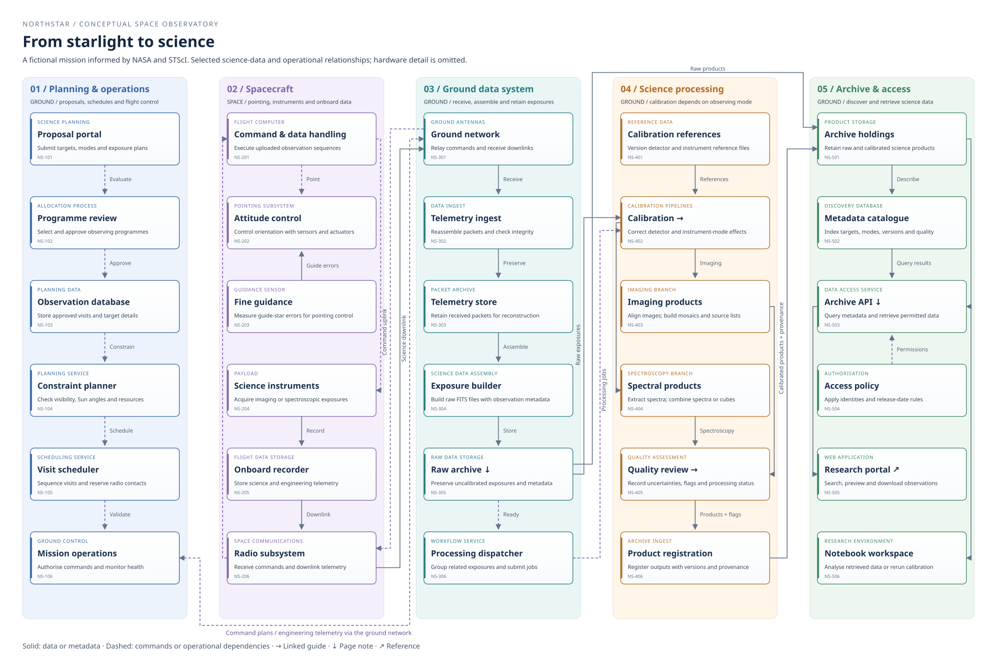

# Space observatory

This fictional space observatory follows an observation from a research proposal
to the science archive. The diagram contains 30 elements across five areas,
including ground systems and spacecraft subsystems.

Select **Expand Space observatory architecture**. Zoom in to read the node
descriptions, then drag to follow the connections between areas.

Select **Calibration** or **Quality review** in the diagram to open the
[processing guide](processing.md#calibration). That page has a smaller diagram
with links back to this overview. These links work inside the viewer too.

## Data note

The raw archive keeps uncalibrated detector exposures and their observation
metadata. These data can produce images or spectra after processing. Workers use
versioned calibration reference files, and researchers can reprocess the
retained data with different software or references. The **Raw archive** node
links to this section.

## Archive access

The archive contains raw exposures and calibrated products, including images,
spectra and source tables. Products carry quality information and processing
provenance, which records their inputs, software and reference versions. Quality
assessment does not imply a manual approval gate for every dataset. Access rules
can restrict data during an exclusive access period.

The **Archive API** node and the smaller diagram link to this section. The
portal and notebook workspace use the API as separate clients.

Read the [quality review guide](processing.md#quality-review) to follow the
processing branches. The **Research portal** node opens the real MAST science
archive in a new tab.

## Sources and simplifications

The model draws on NASA and STScI descriptions of space observatory operations.
It shows selected relationships, not the exact design of JWST or another
mission. Power, thermal control, propulsion and detailed fault handling are
outside its scope. The boxes represent functions and subsystems, not necessarily
separate software services.

NASA's
[Webb communications overview](https://science.nasa.gov/asset/webb/how-stsci-sends-commands-to-webb-and-receives-its-data/)
describes commands and telemetry passing between ground operations and the
spacecraft through a ground network. The
[JWST fine guidance documentation](https://jwst-docs.stsci.edu/jwst-observatory-hardware/jwst-fine-guidance-sensor)
describes guide-star measurements feeding the spacecraft's attitude control,
which controls its orientation.

STScI's
[calibration pipeline overview](https://jwst-docs.stsci.edu/jwst-science-calibration-pipeline)
describes reference data, observing-mode differences and reprocessing.
[MAST's JWST archive description](https://archive.stsci.edu/missions-and-data/jwst)
lists raw, detector-corrected, calibrated and combined products. The diagram
groups these activities to keep the example readable. It does not claim that
every observing mode follows the same processing sequence.
