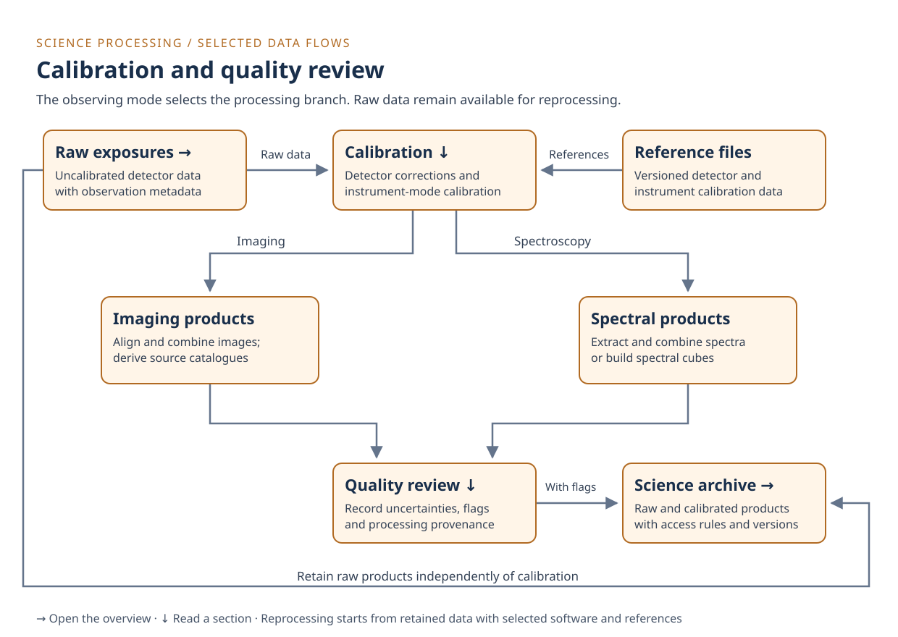

# Science processing

This smaller diagram shows how the observatory calibrates exposures and records
their quality. Imaging and spectroscopy follow different processing branches.
Open it to try navigation at a different diagram size.

Select **Raw exposures** or **Science archive** to return to the
[observatory overview](index.md#archive-access). Select **Calibration** or
**Quality review** to jump to a section below. Try these links with the viewer
open, then use your browser's Back button to return.

## Calibration

Calibration applies detector corrections and instrument-specific corrections for
the observing mode. Versioned reference files supply calibration data and
parameters. Depending on the detector and mode, steps include dark correction,
flat-field correction, wavelength calibration and flux calibration.

Imaging processing can align exposures, build mosaics and derive source
catalogues. Spectroscopic processing can extract and combine spectra or build
spectral cubes. Some modes, such as time-series observations, need other paths
that this simplified diagram omits.

The overview's **Calibration** link opens this section with a query string and a
fragment in the URL. This exercises navigation to a specific section on another
page.

## Quality review

Processing propagates uncertainty estimates and data-quality flags alongside the
science values. Quality assessment records these flags and processing status. It
does not require a person to approve every exposure before archival.

Raw data remain available independently of calibration results. New software or
reference files can trigger reprocessing, even when an earlier run succeeded.
Failed processing jobs need investigation or retry, but unusable measurements
cannot always be corrected in software.

The model follows the broad distinctions in the
[STScI pipeline overview](https://jwst-docs.stsci.edu/jwst-science-calibration-pipeline)
and
[science data overview](https://jwst-docs.stsci.edu/accessing-jwst-data/jwst-science-data-overview).
It groups several processing stages and shows selected data flows.

Return to the [raw data note](index.md#data-note) or the
[archive access note](index.md#archive-access) to continue exploring.
